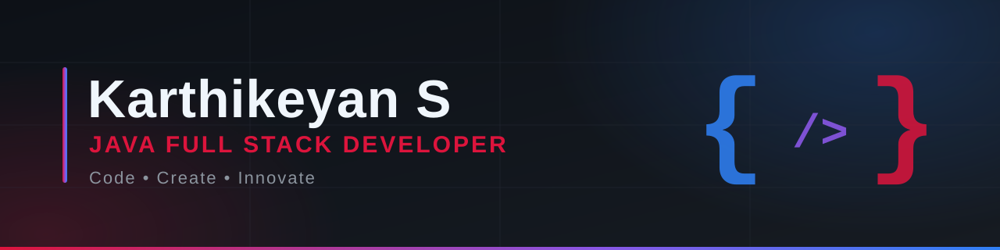

**B.E. Computer Science & Engineering · M.P. Nachimuthu M. Jaganathan Engineering College · Class of 2027**

[Portfolio](https://s-karthikeyan-portfolio.vercel.app/) · [LinkedIn](https://www.linkedin.com/in/karthikeyan-s-467313382/) · [Email](mailto:karthikeyankarthikeyan1710@gmail.com)

---

## About

I'm a final-year Computer Science student building practical software applications and growing as a **Java Full Stack Developer**. I learn by building: database-driven Java applications, web projects, and a personal portfolio, while strengthening my problem-solving and software engineering fundamentals.

I'm looking for **software engineering internships and entry-level opportunities**, and I'm open to collaborating on projects.

## Currently Learning

- Java (object-oriented programming, JDBC, database-backed applications)
- Full-stack web development fundamentals
- Writing cleaner code and better project documentation

## Technical Skills

| Area | Skills |
| --- | --- |
| Programming | Java *(learning)*, Python, C, C++ |
| Web | HTML, CSS, JavaScript |
| Database | MySQL |
| Tools | Git, GitHub, Visual Studio Code |

## Featured Projects

| Project | What it is | Tech |
| --- | --- | --- |
| [**Employee Attendance Tracking System**](https://github.com/KARTHI212006/Employee-Attendance-Tracking-System) | Role-based console app for employee records, attendance, leave requests, and reports. | Java, JDBC, MySQL |
| [**Bus Booking System Management**](https://github.com/KARTHI212006/BusbookingSystemManagement) | Console app for bus and passenger management, ticket booking, cancellation, and payments. | Java, JDBC, MySQL |
| [**Gaming Vault**](https://github.com/KARTHI212006/next-program-) | Dark-themed game-store frontend with wishlist, library, comparison, and cart pages. Demo project with simulated checkout. | React, Vite, Supabase |
| [**Developer Portfolio**](https://github.com/KARTHI212006/Portfolio-) | Personal portfolio with animated sections, project showcase, and résumé. [Live site](https://s-karthikeyan-portfolio.vercel.app/) | Next.js, TypeScript, Tailwind CSS, GSAP |

## GitHub Stats

> Statistics are generated live from my public GitHub data by third-party services. Activity in private repositories is counted only if I have enabled private contributions on my profile.

## Connect

- Portfolio: [s-karthikeyan-portfolio.vercel.app](https://s-karthikeyan-portfolio.vercel.app/)
- LinkedIn: [karthikeyan-s](https://www.linkedin.com/in/karthikeyan-s-467313382/)
- Email: [karthikeyankarthikeyan1710@gmail.com](mailto:karthikeyankarthikeyan1710@gmail.com)

---

Learn consistently. Build thoughtfully. Improve every day.

